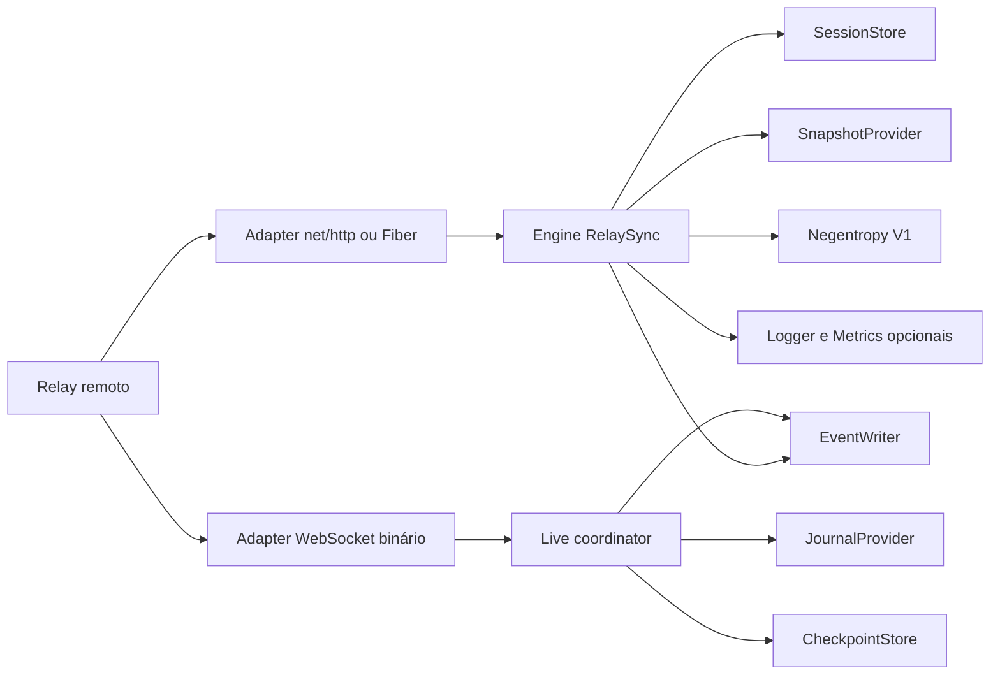

# RelaySync v2: arquitetura

Status: proposta da Fase 0; nenhuma capacidade descrita neste documento está
habilitada no NRServer.

## Contexto e decisões

O RelaySync v2 será uma biblioteca reutilizável dentro do módulo existente
`github.com/gabrielmoura/nostr-relay-server`. Seu diretório público será
**exatamente** `pkg/relaySync` e os arquivos Go usarão `package relaysync`. Não
será criado outro `go.mod` nesta fase.

O repositório usa `docs/` como convenção consolidada para arquitetura, decisões
e planos. Por isso, os documentos pedidos em `__docs/relaysync/` ficam em
`docs/relaysync/`. Essa escolha evita uma segunda árvore documental.

O RelaySync v2 é um protocolo privado/experimental entre relays. Ele não é uma
nova versão oficial do NIP-77. O NIP-77 atual, implementado por
`pkg/negentropy`, `pkg/negentropyV2` e `internal/sync`, permanece separado.

Decisões explícitas do usuário refletidas nesta proposta:

1. Ports and Adapters com interfaces de domínio pequenas e injeção manual por
   construtor.
2. Protobuf v3 é o único formato dos corpos HTTP e das mensagens live.
3. Negentropy Protocol V1 é usado sem alteração de wire format e trafega em
   campos `bytes`.
4. HTTP/2 é uma recomendação de implantação. TLS e negociação HTTP/2 pertencem
   ao roteador/reverse proxy; a biblioteca não abre listener nem administra
   certificados.
5. O adapter Fiber usa o listener já existente. O adapter `net/http` continua
   disponível para outros consumidores.
6. Live sync permanece desabilitado no NRServer até existir journal durável em
   ordem de commit e snapshot ligado ao seu watermark sem lacunas.
7. Nenhum ACK/checkpoint pode preceder a persistência durável do evento ou de
   uma decisão terminal de rejeição.
8. A sincronização é organizada como ciclos finitos. Ao concluir um ciclo, a
   sessão, o snapshot, os estados Negentropy, manifests intermediários e
   buffers são descartados; somente checkpoint opcional permanece quando uma
   retomada futura for necessária.
9. No NRServer, a publicação do journal será baseada em Transactional Outbox no
   PostgreSQL. Redis Pub/Sub só acorda consumidores e nunca fornece replay.

## Evidência do repositório

- O módulo usa Go 1.26.3, Fiber 2.52.12, go-nostr 0.52.3, pgx 5.9.2 e
  go-redis 9.18.0; o router e o WebSocket atual estão em `infra/net` e
  `infra/handler/ws`.
- O adapter reutilizará `internal/policies/hub.go`, mas não `dto.WsServer` nem
  o ACK assíncrono de enqueue, que ocorre antes do commit.
- PostgreSQL é o storage; Redis atende cache/PubSub/fila, não journal durável.
- `NEG-*` e suas sessões permanecem inalterados.

## Fronteiras



O core não pode importar Fiber, pgx, Redis, `internal/*`, `infra/*`,
`config.Cfg`, `dto.WsServer` ou `nostr.Event`. Adapters do NRServer podem
importar o core e as dependências do host; a direção inversa é proibida.

## Estrutura planejada

```text
pkg/relaySync/
  {event,contracts,errors,options,engine,manifest,session}.go
  memory/  conformance/  examples/{nethttp,fiber}/
  internal/{reconcile,negentropyv1,zstdcodec}/
  proto/relaysync/v2/
  relaysynchttp/  relaysyncfiber/  relaysyncws/
```

Subpacotes só serão criados quando a dependência justificar a fronteira. Tipos
de domínio ficam na raiz; `relaysyncfiber` é adapter opcional e pode importar
Fiber, enquanto o core raiz/internal permanece agnóstico.

## Modelo de evento

O core terá seus próprios tipos:

```go
type EventID [32]byte
type PublicKey [32]byte
type Signature [64]byte
type Tag []string

type Event struct {
    ID        EventID
    PublicKey PublicKey
    Signature Signature
    CreatedAt int64
    Kind      uint32
    Tags      []Tag
    Content   string
}
```

As tags preservam ordem e duplicatas. O ID é SHA-256 da serialização canônica
NIP-01 `[0,pubkey,created_at,kind,tags,content]`. Protobuf nunca participa do
cálculo de ID: sua serialização não é canônica. A verificação da assinatura
Schnorr e a conversão para `nostr.Event` ficam em funções explícitas/adapters.

Eventos efêmeros não entram em snapshots duráveis por padrão. Eventos
substituíveis, endereçáveis, removidos por NIP-09 e expirados por NIP-40 são
refletidos pelo conjunto visível do snapshot e pelo journal do host. O core não
sobrescreve a política local.

## Engine e lifecycle

`relaysync.New` recebe dependências obrigatórias explicitamente e opções
funcionais somente para políticas opcionais. O `Engine` é seguro para uso
concorrente, mas uma sessão possui uma máquina de estados serializada:

```text
created -> snapshot_open -> reconciling -> transferring -> catch_up -> live
                                    catch_up/live -> completed
                         any state -> expired/cancelled/failed
```

O engine:

- deriva todos os trabalhos de um `context.Context` fornecido pelo chamador;
- limita sessões, requests simultâneos, rounds, goroutines, bytes e itens;
- mantém ownership único do writer WebSocket;
- fecha snapshot e iteradores em conclusão, cancelamento ou expiração;
- não cria goroutines sem caminho de encerramento observado por `Close`;
- usa relógio injetável apenas onde testes de expiração precisam determinismo.

Um ciclo normal termina com `POST .../{id}/complete` (ou cancelamento/expiração
em caso de falha). `Complete` remove o registro de sessão e fecha o snapshot;
as estruturas de idempotência locais associadas ao ciclo também são removidas.
O `CheckpointStore` é independente: pode manter apenas o cursor necessário para
uma próxima execução, sem manter a sessão que o produziu.

### Persistência e retenção

| Dado | Armazenamento | Retenção |
| --- | --- | --- |
| Eventos aceitos | PostgreSQL existente | Política normal do relay |
| Outbox transacional | PostgreSQL | Remover após publicação segura no journal |
| Journal | PostgreSQL | Janela limitada e independente dos peers |
| Checkpoint | PostgreSQL opcional | Somente quando retomada futura for necessária |
| Sessão, frames, manifests intermediários | Memória/cache | Até complete, cancelamento ou expiração |
| Redis Pub/Sub | Redis existente | Notificação transitória, sem replay |

Não existe uma coleção durável de IDs transferidos por sessão. O journal é
global por escopo/epoch e não é apagado quando um peer termina seu ciclo.

A implementação em memória de `SessionStore` serve a testes e processo único.
Em múltiplas réplicas, o host deve fornecer store compartilhado ou afinidade de
sessão. O token não carrega estado e não transforma um store local em
distribuído.

## Snapshot, manifest e partições

Uma sessão abre um snapshot estável e associa o head durável `W` já produzido
pelo projector do journal. No NRServer, uma transação `REPEATABLE READ` existe
somente durante o build e materializa metadados e payloads autorizados; nenhuma
transação permanece aberta entre requisições. Uma mudança visível no snapshot,
mas projetada depois de `W`, pode reaparecer no replay e é deduplicada por ID.
Uma mudança ausente do snapshot deve aparecer depois de `W`. A garantia é
ausência de lacuna, não atomicidade física entre MVCC e o projector CDC.

Particionamento inicial:

1. bucket temporal `floor(created_at / 2_592_000)` (30 dias desde Unix epoch);
2. um leaf começa com zero bits de prefixo;
3. se `count > max_partition_refs`, dividir pelos próximos quatro bits do Event
   ID e repetir até cada leaf não vazio caber no limite ou atingir 32 bits;
4. filhos vazios são omitidos; `count == max_partition_refs` não divide;
5. ordenação `(created_at, event_id)` dentro da partição.

O plano de shards faz parte do descriptor do snapshot e fica congelado durante
a sessão. Não depende de páginas ou índices do banco.

O digest da partição é:

```text
SHA-256(
  "RelaySync/v2/partition\x00" ||
  canonical_partition_key ||
  uint64_be(event_count) ||
  repeated(int64_be(created_at) || event_id[32])
)
```

`canonical_partition_key` usa campos de tamanho fixo (versão, bucket e número
de bits/prefixo), em big endian. Eventos são ordenados antes do hash. Nenhum
byte Protobuf é usado no digest. Manifestos podem ser cacheados por
`snapshot_version + scope_hash + partition_key`, com invalidação ao expirar a
versão do snapshot.

Somente partições com count/digest diferentes abrem Negentropy. Uma partição
vazia de um lado pode usar transferência integral paginada, ainda sujeita aos
limites e autorização.

## Negentropy

O wire format é o Negentropy Protocol V1 (`0x61`) e não será modificado. A
implementação atual em `pkg/negentropyV2` já contém codec e reconciler em Go,
mas carrega todas as referências fornecidas e pertence ao estado do NIP-77.

Escolha para RelaySync:

- criar uma porta privada em `pkg/relaySync/internal/reconcile`;
- implementar Negentropy V1 independentemente em
  `pkg/relaySync/internal/negentropyv1`, a partir da especificação pública;
- usar packages existentes, inclusive
  `fiatjaf.com/nostr/nip77/negentropy`, somente como referência de comportamento
  e interoperabilidade;
- não importar, copiar ou incorporar código desses packages e não expor seus
  tipos na API;
- executar a suíte oficial de conformidade byte a byte contra a referência;
- operar por partição divergente e impor máximo de referências/bytes por
  partição, em vez de materializar o relay inteiro.

A implementação será derivada do contrato normativo e dos resultados esperados,
não do código-fonte de terceiros. `pkg/negentropyV2` também não será importado
nem copiado. Essa escolha aumenta o custo de auditoria; por isso a Fase 2 não é
aceita até passar vetores, harness cruzado, interoperabilidade e fuzzing.

Os trade-offs de `Vector`, `BTreeMem`, `BTreeLMDB` e `SubRange`, e a justificativa
para Vector particionado com SubRange lógico, estão em
[`negentropy-storage-evaluation.md`](negentropy-storage-evaluation.md).

## Transferência, backpressure e idempotência

Lotes possuem limites simultâneos de quantidade, bytes codificados e bytes
descomprimidos. O produtor só lê a próxima página quando há crédito. No live
sync, `FlowControl` define janela de batches/bytes e o ACK é cumulativo e
contíguo.

`EventWriter` retorna resultado por ID: aceito, já existente, rejeitado
permanentemente ou falha temporária. Aceito, existente e rejeição terminal
duravelmente registrada permitem avançar o cursor. Falha temporária não
permite ACK. Retries usam o mesmo identificador idempotente de operação.

Supressão de eco pode evitar retransmitir imediatamente ao peer que originou a
mudança, mas nunca elimina a gravação no journal nem altera a sequência global.

## Compressão

Será usado `github.com/klauspost/compress/zstd`, já presente indiretamente no
módulo, após fixação como dependência direta. A negociação permite `NONE` e
`ZSTD`; compressão é pulada abaixo de um limiar e quando o resultado não reduz
o payload.

Decoders terão limites de janela e saída, e validarão o tamanho original do
frame. Encoders/decoders podem ser reutilizados em pools limitados; não serão
compartilhados concorrentemente. Níveis equivalentes a zstd 1 e 3 serão
comparados por benchmark antes de escolher o default. Zstd pode ser
desabilitado.

## Segurança e observabilidade

`PeerAuthorizer` recebe principal autenticado, ação e escopo. Descobrir
capabilities não concede acesso. Tokens de sessão são aleatórios, opacos,
expiráveis, vinculados a peer e scope, comparados em tempo constante e
armazenados como hash quando persistidos. IP nunca identifica peer.

TLS/mTLS, NIP-98 ou autenticação HTTP são responsabilidades do adapter/host.
O WebSocket revalida token, identidade, subprotocolo e escopo no handshake.

Logging usa `log/slog` por uma interface mínima ou `*slog.Logger`; payloads,
tokens, IDs de sessão e conteúdo não entram em logs. Métricas são callbacks
opcionais e não usam peer/event/session como labels. O adapter NRServer mapeia
essas métricas ao Prometheus existente.

## Integração NRServer e gates

A integração só começa após core, HTTP, live e adapters genéricos passarem seus
testes essenciais. Ela será desabilitada por padrão.

Gates antes de habilitar:

- snapshot consistente reutilizável por múltiplas requisições;
- journal cobrindo todos os caminhos de insert/delete/replace/expire;
- ordem de commit comprovada, gap/epoch e retenção implementados;
- política de escrita reutilizando validação e persistência atuais;
- autenticação por peer/scope;
- terminação TLS no roteador e limites operacionais configurados;
- coexistência e regressão do NIP-77 verificadas.

O NIP-11 poderá publicar uma extensão própria somente quando a capacidade
estiver ativa. `supported_nips: 77` continuará significando apenas NIP-77.

## Riscos não resolvidos

1. O PostgreSQL atual não oferece snapshot versionado nem journal durável. Uma
   migration será necessária para artifacts/materialização e journal; desenho
   e impacto em bases grandes exigem aprovação antes de SQL.
2. A decisão é Transactional Outbox no PostgreSQL, que exige cobrir todos os
   writers e deletes existentes na mesma transação. O projector deve publicar
   em ordem de commit e remover a outbox somente após confirmação durável. CDC
   permanece alternativa futura, não habilitada por esta arquitetura.
3. Manter transação `REPEATABLE READ` por toda uma sessão prejudica vacuum e
   ocupa conexão; não é a estratégia de produção proposta.
4. A implementação Negentropy independente ainda precisa da suíte oficial de
   conformidade e comparação cruzada.
5. Escala de 10 milhões não foi medida. Nenhuma alegação de produção ou escala
   será feita antes dos benchmarks previstos.

## Referências

- [NIP-01](https://github.com/nostr-protocol/nips/blob/master/01.md)
- [NIP-77](https://github.com/nostr-protocol/nips/blob/master/77.md)
- [Negentropy](https://github.com/hoytech/negentropy)
- [Referência comportamental Go](https://pkg.go.dev/fiatjaf.com/nostr/nip77/negentropy)
- [Protobuf não é serialização canônica](https://protobuf.dev/programming-guides/serialization-not-canonical/)
- [RFC 8878: Zstandard](https://www.rfc-editor.org/rfc/rfc8878.html)
