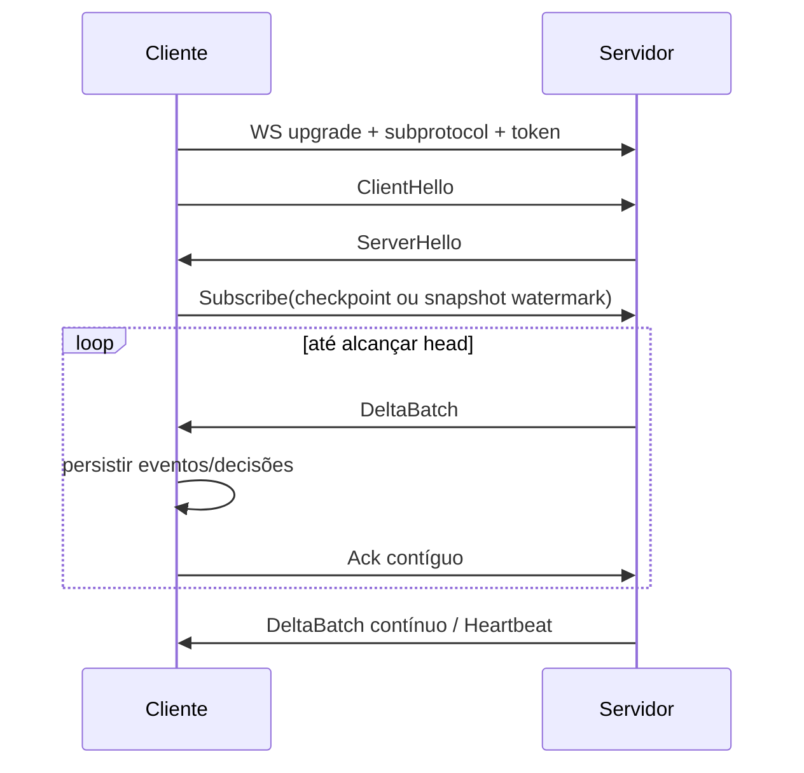

# RelaySync v2: protocolo

Status: contrato proposto na Fase 0. RelaySync v2 não é uma especificação NIP.

## Objetivos de wire protocol

- Protobuf v3 em todos os payloads.
- Binário ponta a ponta; IDs e frames nunca são hex/Base64 no wire.
- Versionamento explícito e evolução compatível.
- Limites antes de alocar ou descomprimir.
- Requisições retomáveis e idempotentes.
- Separação entre reconciliação histórica e live journal.
- Nenhuma declaração de convergência fora do scope/policy negociado.
- Ciclos finitos: o estado temporário termina em `complete`, cancelamento ou
  expiração; o journal não é um estado por peer.

## Content types e versões

HTTP usa:

```text
Content-Type: application/x-protobuf
Accept: application/x-protobuf
Content-Encoding: zstd        # somente quando negociado
Accept-Encoding: zstd         # opcional
```

O primeiro protocolo suportado é `2`. Negociação escolhe a maior versão comum.
O `protocol_version` aparece nas mensagens de abertura/hello e não é inferido
da URL. A URL `/sync/v2` identifica a família, não elimina negociação.

Enums têm valor zero `*_UNSPECIFIED`. Números de campo nunca são reutilizados;
campos removidos serão `reserved`. Campos escalares que distinguem ausência de
zero usam `optional`. Mensagens mutuamente exclusivas usam `oneof`.

O schema fonte ficará em
`pkg/relaySync/proto/relaysync/v2/relaysync.proto`, com `go_package` apontando
para o módulo atual. Código `.pb.go` é gerado, nunca editado manualmente.

Geração planejada e reproduzível:

```bash
make generate-relaysync
```

O target valida `protoc` 35.0, resolve o `protoc-gen-go` fixado pelo módulo com
`go tool -n`, passa seu caminho por `--plugin`, gera Go com paths relativos e
também gera um descriptor set com imports. O binário encontrado no `PATH` não é
uma versão implícita. Buf não será introduzido na Fase 1; descriptor set e
golden tests cobrem a regressão inicial de schema.

## Tipos e validação binária

Tamanhos validados antes da conversão:

| Campo | Tipo Protobuf | Tamanho |
| --- | --- | --- |
| Event ID | `bytes` | 32 |
| Public key | `bytes` | 32 |
| Signature | `bytes` | 64 |
| Session ID | `bytes` | 16 |
| Session token | `bytes` | 32 mínimo |
| SHA-256 digest | `bytes` | 32 |
| Negentropy frame | `bytes` | 1..max negotiated |

Timestamp Nostr é `int64`; valores negativos e o valor reservado pelo
Negentropy são rejeitados na reconciliação. `kind` é `uint32`. Tags usam uma
mensagem `Tag { repeated string values = 1; }` para preservar limites e ordem.

## Mensagens Protobuf

O schema será dividido logicamente, mas pode permanecer em um arquivo na
primeira versão para simplificar geração.

### Negociação

- `CapabilitiesRequest`: vazio e extensível.
- `Capabilities`: versões, compressões, features, limites públicos e
  identificador de implementação não sensível.
- `Limits`: bytes/frame/request/decompressed, eventos/batch, sessões, rounds,
  partições e TTLs.
- `SyncScope`: nome, versão, hash de política e parâmetros canônicos.
- `OpenSessionRequest`: versões, compressões, scope, direção e nonce.
- `OpenSessionResponse`: versão/compressão escolhidas, ID/token binários,
  limites efetivos, expiração, snapshot e estado inicial.
- `Snapshot`: versão, scope hash, watermark, expiração e versão do plano de
  partição.

`Capabilities` é descoberta, não autorização. Limites efetivos podem ser mais
restritivos após autenticação.

### Manifest e reconciliação

- `ManifestRequest`: session ID, snapshot version, continuation token e limite.
- `Manifest`: snapshot, `repeated PartitionSummary` e próxima continuação.
- `Partition`: bucket temporal, prefix bits/prefix e versão do algoritmo.
- `PartitionSummary`: partition, count, digest e flags de disponibilidade.
- `ReconcileRequest`: session, partition, round e Negentropy frame em `bytes`.
- `ReconcileResponse`: round, frame, IDs locais/remotos descobertos, `done` e
  erro tipado quando aplicável.

Continuation tokens são opacos, vinculados a sessão/snapshot/scope, expirados e
autenticados pelo servidor. Não codificam offset mutável.

Negentropy opera somente dentro de uma partição divergente. `round` começa em 1,
é estritamente crescente por partição e tem limite negociado. Frame vazio,
versão inválida, round repetido com conteúdo diferente ou excesso de tamanho
encerra aquela reconciliação.

### Transferência

- `PullEventsRequest`: session, operation ID, IDs, limite e continuação.
- `PullEventsResponse`: `repeated Event`, IDs ausentes tipados, continuação e
  checksum do batch.
- `PushEventsRequest`: session, operation ID e eventos.
- `PushEventsResponse`: `repeated EventReceipt` na ordem da entrada.
- `EventReceipt`: ID, status, error code, policy version e mensagem segura.
- `ReadChangesRequest`: session, cursor, limites de itens/bytes e wait timeout.
- `ReadChangesResponse`: mudanças ordenadas, próximo cursor, head e continuação.

`operation_id` permite repetir request após timeout. O servidor guarda/deduz o
mesmo resultado durante a janela de idempotência. Um mesmo operation ID com
payload diferente retorna `IDEMPOTENCY_CONFLICT`.

### Live sync

`LiveEnvelope` usa `oneof body`:

- `ClientHello`
- `ServerHello`
- `Subscribe`
- `DeltaBatch`
- `Ack`
- `FlowControl`
- `Heartbeat`
- `ReconcileRequired`
- `ProtocolError`

`JournalChange` é item de `DeltaBatch`. `DeltaBatch` informa epoch, primeiro e
último cursor, batch ID e bytes/eventos. `Ack` contém o maior cursor contíguo
duravelmente processado. `FlowControl` atualiza crédito em batches e bytes;
crédito zero pausa envio sem fechar a sessão.

`Heartbeat` contém nonce e cursor observado, sem substituir ACK. Timeout de
heartbeat fecha a conexão, não a sessão durável. `ReconcileRequired` carrega
motivo (`GAP`, `EPOCH_CHANGED`, `SCOPE_CHANGED`, `SNAPSHOT_EXPIRED`) e encerra o
replay até nova reconciliação HTTP.

## Endpoints HTTP

| Método e path | Request | Response | Idempotência |
| --- | --- | --- | --- |
| `GET /sync/v2/capabilities` | vazio | `Capabilities` | naturalmente idempotente |
| `POST /sync/v2/sessions` | `OpenSessionRequest` | `OpenSessionResponse` | nonce + principal |
| `POST /sync/v2/sessions/{id}/manifest:next` | `ManifestRequest` | `Manifest` | token opaco |
| `POST /sync/v2/sessions/{id}/reconcile` | `ReconcileRequest` | `ReconcileResponse` | partição + round + hash |
| `POST /sync/v2/sessions/{id}/events:pull` | `PullEventsRequest` | `PullEventsResponse` | operation ID |
| `POST /sync/v2/sessions/{id}/events:push` | `PushEventsRequest` | `PushEventsResponse` | operation ID |
| `POST /sync/v2/sessions/{id}/changes:next` | `ReadChangesRequest` | `ReadChangesResponse` | cursor exclusivo |
| `POST /sync/v2/sessions/{id}/complete` | `CompleteSessionRequest` | `CompleteSessionResponse` | uma vez por ciclo; retry após resposta é terminal |
| `DELETE /sync/v2/sessions/{id}` | vazio | vazio | repetível |

O ID no path usa base64url sem padding; no Protobuf permanece `bytes`. Token de
sessão vai em header de autorização do adapter, nunca no path ou log.

### Lifecycle de um ciclo

```text
open -> snapshot/watermark -> manifest/reconcile -> pull/push
     -> catch-up opcional -> live opcional -> complete
```

`complete` só deve ser enviado depois de todas as decisões terminais terem sido
persistidas. O servidor fecha o snapshot, descarta estados Negentropy,
manifests, frames e buffers, e remove a sessão. Um checkpoint persistente, se
configurado, é independente e contém apenas o cursor necessário para uma nova
execução. Uma falha ou desconexão não transforma automaticamente o ciclo em um
serviço permanente: o cliente retoma com checkpoint ou abre uma nova sessão.

Status HTTP representa falha do envelope/transporte; resultados por evento
ficam no Protobuf. Mapeamento inicial:

| Status | Código de protocolo |
| --- | --- |
| 400 | malformed/invalid argument |
| 401 | unauthenticated/token invalid |
| 403 | unauthorized scope/action |
| 404 | session/snapshot unknown |
| 409 | state/round/idempotency conflict |
| 410 | snapshot expired/journal gap |
| 413 | encoded/decompressed limit |
| 429 | rate/session/concurrency limit |
| 500 | internal |
| 503 | temporary storage unavailable |

Responses de erro também são Protobuf (`ErrorResponse`) e não expõem SQL,
stack, token ou conteúdo.

HTTP/2 é recomendado no edge. A biblioteca não configura SSL; no NRServer, o
roteador termina TLS/H2 e encaminha ao Fiber. HTTP/3 é opcional e externo.

## WebSocket

Endpoint: `/sync/v2/live`

Subprotocolo obrigatório: `nostr-sync.v2.pb` (nome fixado pelo requisito do
protocolo, embora a implementação seja denominada RelaySync).

Somente frames WebSocket binários são aceitos. Mensagem textual fecha com erro
de protocolo. `permessage-deflate` deve estar desabilitado; zstd de aplicação é
negociado no hello.

### Cabeçalho

Cada mensagem WebSocket contém cabeçalho de 8 bytes seguido por um
`LiveEnvelope`:

```text
offset  size  campo
0       2     magic: 0x52 0x53 ("RS")
2       1     framing version: 0x02
3       1     flags: bit 0 = zstd; bits 1..7 = 0
4       4     tamanho original uint32 big-endian
8       N     payload protobuf, comprimido ou não
```

O tamanho do payload transmitido já vem do framing WebSocket e não é duplicado.
Para payload sem compressão, `original_size == N`. Para zstd, é o tamanho
esperado após descompressão e deve ser menor ou igual ao limite negociado.
Magic, versão, flags reservadas ou tamanho inválidos encerram a conexão.

### Handshake e replay



O fluxo sem perda é:

1. abrir snapshot e associar o head durável `W` do journal;
2. reconciliar exatamente a versão por HTTP;
3. usar `changes:next` após `W` até alcançar o head, aceitando duplicatas;
4. chamar `complete`, que sela a fase histórica, libera o snapshot e remove a
   sessão/token e o estado temporário do ciclo;
5. assinar live após o último cursor confirmado;
6. continuar recebendo journal em um novo ciclo live, quando habilitado.
   `DELETE` cancela explicitamente um ciclo ainda aberto.

Se o journal não consegue servir o cursor, envia `ReconcileRequired`. O cliente
nunca pula automaticamente para o primeiro cursor retido.

## Compressão zstd

Negociação escolhe `COMPRESSION_NONE` ou `COMPRESSION_ZSTD`. HTTP segue
`Content-Encoding`; WebSocket usa a flag do cabeçalho. Limites são aplicados ao
corpo comprimido e descomprimido.

Regras:

- não comprimir abaixo do threshold configurado;
- aceitar zstd somente se anunciado e escolhido;
- limitar janela e memória do decoder;
- rejeitar trailing frames/dados inesperados;
- validar o tamanho original antes e depois da decodificação;
- usar encoders/decoders com concorrência limitada;
- não comprimir novamente eventos já incompressíveis quando o ganho for menor
  que o mínimo configurado.

## Limites mínimos obrigatórios

Toda implementação configura valores finitos para:

- corpo HTTP codificado e descomprimido;
- frame WebSocket codificado e descomprimido;
- frame Negentropy e rounds;
- eventos, IDs, tags, strings e bytes por batch;
- páginas de manifest e partições por sessão;
- sessões totais e por peer;
- requests/goroutines concorrentes;
- TTL de sessão, snapshot, idempotência e heartbeat;
- crédito live e journal lag máximo.

Defaults concretos serão medidos e congelados na Fase 1; até lá, zero não
significa ilimitado e configuração inválida impede `New`.

## Evolução e golden tests

Os testes mantêm descriptor set e bytes golden; detectam renumeração/remoção
não reservada; cobrem campos desconhecidos, enums/oneofs inválidos, frames
comprimidos ou não; e fuzzam Protobuf, framing, zstd e Negentropy.

Protobuf não é usado como hash canônico de evento, manifest ou idempotency
payload. Onde um hash é necessário, o protocolo define serialização canônica
separada.

## Referências

- [Protocol Buffers: proto3](https://protobuf.dev/programming-guides/proto3/)
- [Protocol Buffers: serialization is not canonical](https://protobuf.dev/programming-guides/serialization-not-canonical/)
- [NIP-77](https://github.com/nostr-protocol/nips/blob/master/77.md)
- [Negentropy Protocol V1](https://github.com/hoytech/negentropy/blob/master/docs/negentropy-protocol-v1.md)
- [RFC 8878: Zstandard](https://www.rfc-editor.org/rfc/rfc8878.html)
